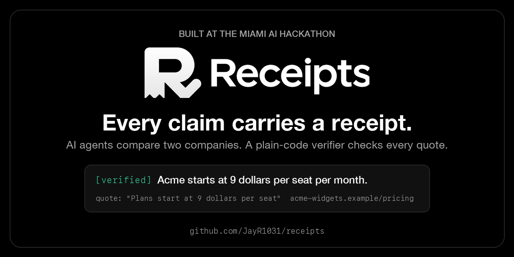
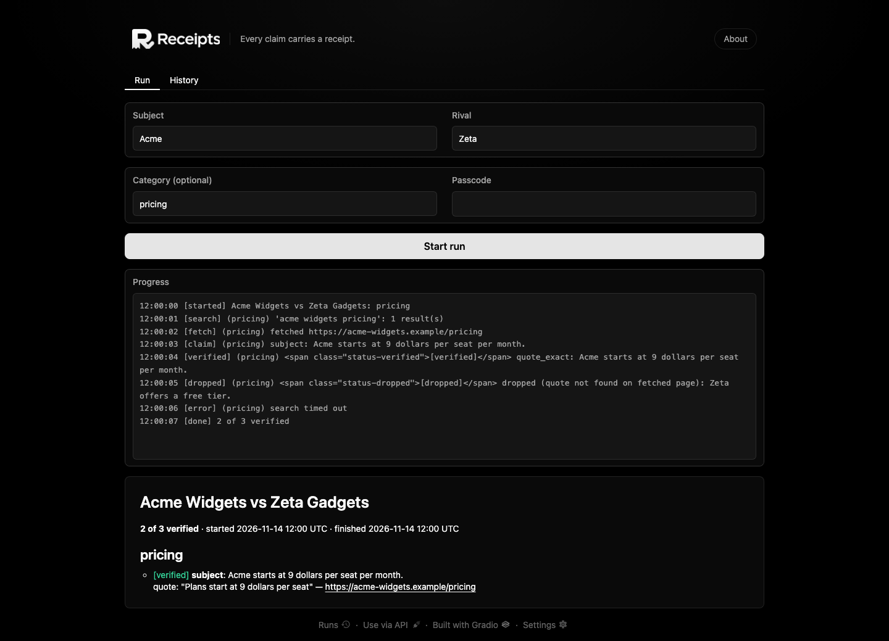
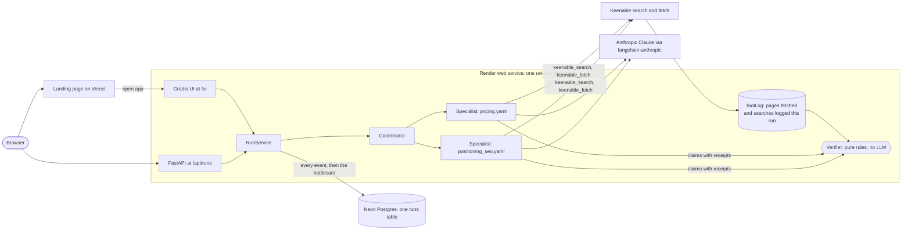
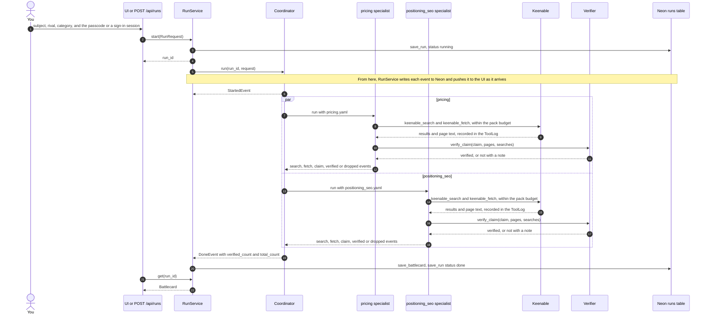
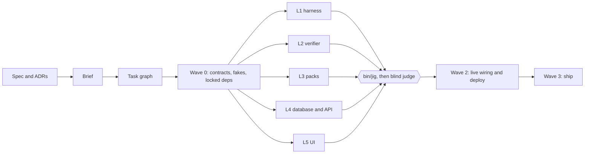
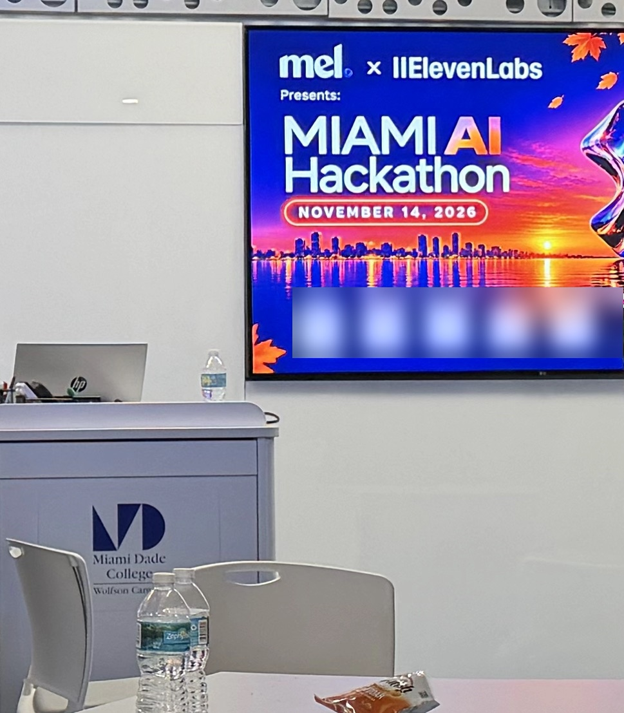

<div align="center">

<h1></h1>

<br>

A crew of AI agents that compares two companies and hands you a battlecard where every line is
checked against the web page or search result it came from.

[](https://github.com/JayR1031/receipts/actions/workflows/ci-python.yml)
[](https://github.com/JayR1031/receipts/actions/workflows/security.yml)


**[Try the live app](https://receipts-h745.onrender.com) &nbsp;·&nbsp; [Talk to Receipts](https://receipts-landing-nine.vercel.app) &nbsp;·&nbsp; [How it works](#how-it-works) &nbsp;·&nbsp; [The verifier](#the-verifier)**



<sub>The UI replaying its built-in demo run (invented companies). Screenshot from 2026-11-15, before sign-in was added.</sub>

</div>

<table>
<tr>
<td width="33%" valign="top">

**Receipts, or it doesn't count**

A claim gets through only with a receipt: a quote from a page fetched during this run, or a
search result logged during this run.

</td>
<td width="33%" valign="top">

**A verifier with no language model**

Plain code re-checks every receipt against what the run actually saw. The battlecard shows
"N of M verified" and, for every miss, the reason.

</td>
<td width="33%" valign="top">

**A specialist is one YAML file**

A prompt, query templates and a search budget. Two packs ship today: pricing, and positioning
and SEO.

</td>
</tr>
</table>

## Try it

| | Where | What you need |
|---|---|---|
| **The app** | [receipts-h745.onrender.com](https://receipts-h745.onrender.com) | Reading past battlecards in History: nothing. Starting a run: the public demo passcode **`receipts-demo`**, or Google sign-in. Only the repository owner can sign in while the Google OAuth app is in Testing mode. |
| **The voice agent** | [receipts-landing-nine.vercel.app](https://receipts-landing-nine.vercel.app), "Talk to Receipts" | Nothing. It reads the app's public run list and battlecards (ElevenLabs). |
| **The API** | [API quickstart](#api-quickstart) | The passcode header (`X-Demo-Passcode: receipts-demo`) to start a run; nothing to read one. |

> [!NOTE]
> **Status on `main` (2026-11-18).**
> - **Live comparisons.** Claude agents search and fetch with Keenable, every claim goes through the verifier, and runs are stored in Neon. A claim that fails gets up to two Mellea rewrites; those were measured locally, not yet on the deployed app ([Demo: Mel vs Warp](#demo-mel-vs-warp)).
> - **Limits.** Signed-out runs (the UI with the passcode, and every API start) share one cap per UTC day: 10 on the deployed app, where `SIGNED_OUT_RUNS_PER_DAY` is set to 10 (2026-11-20); the code's default is 20. The deployed passcode, `receipts-demo`, is public on purpose: the shared cap, not the passcode, is what limits spend. A signed-in person may start 5 per UTC day (issue #41, ADR-0008).
> - **Without the live settings** (`ANTHROPIC_API_KEY`, `KEENABLE_API_KEY` and `DATABASE_URL`), the app serves one built-in demo run of invented companies instead (`src/receipts/api/wiring.py`). The UI replays it with no setup at all, and offers no sign-in. `POST /api/runs` still checks the passcode first (401 without one) and then the Keenable key (503 without it).
> - **First load.** The app runs on Render's free tier, which sleeps after 15 minutes idle, so the first load can take about a minute (Render's free-tier docs, cited in ADR-0005).

## Contents

- [The problem, the answer](#the-problem-the-answer)
- [What you see in 30 seconds](#what-you-see-in-30-seconds)
- [How it works](#how-it-works)
- [The verifier](#the-verifier) (full rules and examples: [docs/verifier.md](docs/verifier.md))
- [Add a specialist in one YAML file](#add-a-specialist-in-one-yaml-file)
- [API quickstart](#api-quickstart)
- [Run locally](#run-locally)
- [Tests and gates](#tests-and-gates)
- [Demo: Mel vs Warp](#demo-mel-vs-warp)
- [How it was built at the Miami AI Hackathon](#how-it-was-built-at-the-miami-ai-hackathon)

## The problem, the answer

**The problem.** Ask an AI research agent to compare you with a rival and you get a confident
page of prices and positioning. You cannot tell which lines it read and which it made up.

**The answer.** Receipts lets a claim through only with a *receipt*: either a quote plus the URL
of a page fetched during this run, or a search result (query, rank, URL) logged during this run.
A plain-code verifier, with no language model involved, re-checks every receipt against what the
run actually saw. The battlecard shows the score ("N of M verified") and, for every claim that
failed, the reason.

## What you see in 30 seconds

1. Type a **subject** (you), a **rival** and an optional **category**. Signed out, add the demo passcode (`receipts-demo` on the deployed app); signed in with Google, the passcode field is hidden and the line under the header shows your count, such as `0 of 5 runs used today (UTC)`.
2. Two specialists run in parallel, one per domain pack: `pricing` and `positioning_seo`. The built-in demo replay, used when the live settings are not all set, covers the pricing pack only.
3. The progress log names each step: `started`, `search`, `fetch`, `claim`, `verified`,
   `dropped`, `error`, `done`.
4. The battlecard groups claims by domain. Each claim is marked `[verified]` or `[unverified]`
   with its note and its receipt (the quote and a link to the page, or the search query and rank).
5. The History tab lists past runs, newest first: signed in, your own runs; signed out, the runs that belong to no one. Click one to reopen its battlecard.

<details>
<summary>The progress log, exactly as the UI prints it (built-in demo replay, invented companies)</summary>

```text
12:00:00 [started] Acme Widgets vs Zeta Gadgets: pricing
12:00:01 [search] (pricing) 'acme widgets pricing': 1 result(s)
12:00:02 [fetch] (pricing) fetched https://acme-widgets.example/pricing
12:00:03 [claim] (pricing) subject: Acme starts at 9 dollars per seat per month.
12:00:04 [verified] (pricing) quote_exact: Acme starts at 9 dollars per seat per month.
12:00:05 [dropped] (pricing) dropped (quote not found on fetched page): Zeta offers a free tier.
12:00:06 [error] (pricing) search timed out
12:00:07 [done] 2 of 3 verified
```

Produced by `receipts.ui.render.render_event_line` over `receipts.ui.demo.demo_events()`. The app
replays this script whenever no live run service is wired in. The script is abridged: it shows one of its three claims, so the done line does not match the events above it.

</details>

## How it works

One process serves everything: FastAPI for the JSON API, with the Gradio UI mounted into the same
app at `/ui` (ADR-0005). A *specialist* is one generic agent runner configured by a YAML *domain
pack*. The *Coordinator* runs one specialist per pack at the same time, up to
`MAX_CONCURRENT_SPECIALISTS`, and merges their event streams.



One run, step by step:



<details>
<summary>Details that matter, read from the code</summary>

- **Agents.** Each specialist is a LangChain 1.x `create_agent` over Claude (`claude-sonnet-5-5`,
  `effort` set per pack). Tool budgets are enforced with `ToolCallLimitMiddleware` on the exact
  tool names `keenable_search` and `keenable_fetch`, and the whole agent call has the pack's
  `timeout_s` (`src/receipts/harness/specialist.py`).
- **Claims.** The agent ends with a fenced JSON list of claims, each with a quote or search
  receipt. A final message with no parseable list becomes an `error` event for that domain, not a
  crash.
- **Repairs (Mellea).** A claim the verifier would not verify gets up to two rewrites before it
  is judged, through [Mellea](https://mellea.ai)'s instruct-validate-repair loop. The requirement
  is the verifier itself, and its reason for failing is the feedback for the next rewrite. Mellea
  never marks a claim verified: the repaired claim goes to the verifier like any other, and a claim
  still failing after two rewrites, or when the pack's time runs out, is judged as the agent
  wrote it (`src/receipts/harness/repair.py`, ADR-0007).
- **The log is the source of truth.** The tools record every result in a per-run `ToolLog`.
  Agents see a page cut to 6000 characters; the verifier reads the full text
  (`src/receipts/harness/tools.py`).
- **Streaming.** Each specialist's events are replayed from its `ToolLog` when its agent finishes,
  so the progress log fills in one burst per pack. A specialist that raises becomes an `error`
  event and the other one still finishes (`coordinator.py`).
- **Counting.** `total_count` counts `claim` events and `verified_count` counts `verified` events.
  Every claim that does not verify is emitted as `dropped` and stays on the battlecard as
  `[unverified]`, with its note.
- **Storage.** A `runs` table: `id, created_at, subject, rival, category, status, battlecard`
  (JSON), `events` (JSON), `user_id` (NULL for a signed-out run); and a `users` table for people
  who signed in with Google: `id, sub, email, created_at` (`src/receipts/db/schema.py`).
- **Sign-in.** Optional Google sign-in (OpenID Connect, authorization code with PKCE) at `/auth/*`,
  in the same process. The ID token's RS256 signature is checked against Google's published keys
  with `joserfc`, then its issuer, audience, expiry and nonce. The session is a signed cookie that
  holds our user id and an expiry, 7 days (`src/receipts/auth/`, ADR-0008).
- **Wiring.** With `ANTHROPIC_API_KEY`, `KEENABLE_API_KEY` and `DATABASE_URL` all set, the API
  and UI run the live service: Claude, Keenable, Neon and Mellea repairs (`build_live_service`
  in `src/receipts/api/wiring.py`). Otherwise they serve the built-in demo replay.

</details>

## The verifier

`src/receipts/verify/rules.py` is pure: no clock, no network, no model call. Before matching it
*normalizes* both the quote and the page: markdown stripped, curly quotes and dashes unified,
lower-cased, whitespace collapsed.

| Receipt | Check | Outcome | Note on the claim |
|---|---|---|---|
| Quote | URL was not fetched this run | not verified (dropped) | `dropped: url not fetched this run` |
| Quote | Page fetch failed | not verified | `fetch failed` (not "false") |
| Quote | Quote is an exact substring of the page | `quote_exact` | none |
| Quote | Exact substring, but an edge of the match cuts a page number (`$19` inside `$199`) | falls through to the fuzzy check | |
| Quote | Fuzzy match: `rapidfuzz` `partial_ratio` at least 90, the match covers the whole quote, and each number in the quote is the page's number at the same place in the match | `quote_fuzzy` | `fuzzy match: partial_ratio=… >= 90` |
| Quote | The quote is on the page, but a value in the claim (a price with a currency sign or written out as `25 dollars` or `$ 25`, a `%`, a decimal, a thousands number, or a count such as `500 credits`) is not in the quote | not verified | `claim numbers not in quote: …` |
| Quote | Anything else | not verified | `quote not found on page: …` with the reason |
| Search | Same query, rank and URL as a row logged this run | `search_log` | none |
| Search | Query was never searched this run | not verified (dropped) | `dropped: search query not logged this run` |
| Search | Query logged, but no row with that rank and URL | not verified | `no logged row for query at rank N with that url` |

The number rules in plain words, the known limits and seven worked examples with the verifier's
real output are in **[docs/verifier.md](docs/verifier.md)**. Two of the limits, both accepted by
the repository owner on 2026-11-18: plan labels next to a price are not checked (in PR #35's
random tests, 22 of 160,000 generated quotes on two- to four-price pages verified with a price
that is not their plan's), and a true quote whose page text runs past the fuzzy score's window
can be rejected (195 of 5,998 true quotes in the same tests). Prices with a suffix, such as
`$20k`, are now read as one number, `$20,000`, in the claim and in the quote (issue #45). One edge
of that is also a known limit: a quote cut mid-word at `$5m` from a page's `$5mo` reads five
million, so a true `$5` claim is rejected and a wrong `$5,000,000` one verifies.

### How accurate is the verifier?

Measured on 231 claims from ten real runs, each labeled by whether its receipt really backs it
(issue #59; [docs/verifier-eval.md](docs/verifier-eval.md)). On the 147 whose pages and search
rows were recorded, the verifier is re-run offline in CI:

- **Recall 99%** (96 of 97): it almost never rejects a claim its receipt backs.
- **Precision 74%** (96 of 129; 95% CI 66% to 81%): about one verified claim in four says more
  than its receipt. Almost all of those add words, not numbers (a feature, an audience, a
  comparison with other search results), which the number rules do not read.
- **Mellea's rewrites** of the 17 failing claims were all backed by their receipts.

CI fails if precision drops below 72% or recall below 97%. The labels were drafted by an AI
assistant and reviewed by the repository owner; one labeler, pages as fetched on 2026-11-20.

## Add a specialist in one YAML file

A specialist is configuration, not code. This is `src/receipts/packs/pricing.yaml`, with the
prompt shortened:

```yaml
id: pricing
display_name: Pricing
model: claude-sonnet-5-5
effort: medium
system_prompt: |
  You are the pricing specialist. Compare how the subject and the rival charge: plan names,
  per-seat or usage prices, billing periods, free tiers and limits.
  Return a claim only with a receipt. [...]
query_templates:
  - "{subject} pricing"
  - "{rival} pricing"
  - "{subject} vs {rival} price per seat {category}"
  - "{category} pricing plans free tier limits {subject} {rival}"
max_searches: 4
max_fetches: 5
timeout_s: 120
rubric: |
  A good pricing claim names a plan and a price or limit, quotes it verbatim from an official
  page, and says which company it is about. [...]
```

The schema is `DomainPack` in `src/receipts/contracts.py`; `load_pack(name)` validates it and a
bad field fails with the field's name. `{subject}`, `{rival}` and `{category}` are filled from
the run request, and the rubric and budget are appended to the system prompt. A pack's `id` must
be one of the four `Domain` values in the contracts (`pricing`, `positioning_seo`, `news_social`,
`product`); two packs ship today.

## API quickstart

Every `POST /api/runs` is a signed-out run: it needs the passcode header `X-Demo-Passcode`
(`PASSCODE_HEADER` in `src/receipts/api/routes.py`) and counts against the signed-out cap (20 per
UTC day by default; the deployed app sets 10 and uses the public passcode `receipts-demo`), even with a session cookie. Reading needs no passcode. `GET /api/runs`
without a session cookie lists the runs that belong to no one. Sign-in routes are in
[`docs/api.md`](docs/api.md).

```bash
BASE=https://receipts-h745.onrender.com
DEMO_PASSCODE=receipts-demo

# Start a run: 202 with {"run_id": "run-…"}. The deployed app runs a live comparison. With the passcode and Keenable key set but the other live settings missing, any subject and rival return the Acme vs Zeta demo battlecard
curl -sS -X POST "$BASE/api/runs" \
  -H "Content-Type: application/json" \
  -H "X-Demo-Passcode: $DEMO_PASSCODE" \
  -d '{"subject": "Mel", "rival": "Warp", "category": "agentic terminal"}'

# One run's battlecard (404 until a battlecard is stored)
curl -sS "$BASE/api/runs/$RUN_ID"

# History, newest first (no session cookie: the runs that belong to no one)
curl -sS "$BASE/api/runs"
```

| Call | Success | Errors |
|---|---|---|
| `POST /api/runs` | `202 {"run_id": "..."}` | `401` passcode missing or wrong, `429` `10 of 10 signed-out runs used today (UTC); the limit resets at 00:00 UTC` (deployed cap), `503` `KEENABLE_API_KEY is not set`, `422` bad body |
| `GET /api/runs/{run_id}` | `200` `Battlecard` | `404` `run <id> not found` |
| `GET /api/runs` | `200` list of `RunSummary`: with a valid session cookie, that person's runs; without one, the runs with no user | none |
| `GET /auth/me` | `200 {"email": "..."}` for a valid session | `401` `not signed in` |
| `GET /healthz` | `200 {"status": "ok", "sha": "...", "version": "..."}` | none |

<details>
<summary>JSON shapes (from <code>src/receipts/contracts.py</code>; values from the built-in demo)</summary>

`RunRequest`: `{"subject": str, "rival": str, "category": str | null}`. Unknown fields are
rejected.

`Battlecard`:

```json
{
  "run_id": "run-demo-0001",
  "subject": "Acme Widgets",
  "rival": "Zeta Gadgets",
  "claims": [
    {
      "domain": "pricing",
      "about": "subject",
      "text": "Acme starts at 9 dollars per seat per month.",
      "receipt": {
        "kind": "quote",
        "url": "https://acme-widgets.example/pricing",
        "quote": "Plans start at 9 dollars per seat"
      },
      "verified": true,
      "verify_method": "quote_exact",
      "verify_note": null
    }
  ],
  "verified_count": 2,
  "total_count": 3,
  "started_at": "2026-11-14T12:00:00Z",
  "finished_at": "2026-11-14T12:00:11Z"
}
```

A search receipt is `{"kind": "search", "query": str, "rank": int, "url": str, "ts": datetime}`.

`RunSummary` (one row of `GET /api/runs`):

```json
{
  "run_id": "run-demo-0001",
  "subject": "Acme Widgets",
  "rival": "Zeta Gadgets",
  "status": "done",
  "verified_count": 2,
  "total_count": 3,
  "started_at": "2026-11-14T12:00:00Z"
}
```

The full schema is in `docs/api/openapi.json`.

</details>

## Run locally

```bash
uv sync
uv run uvicorn receipts.api.app:app --reload   # http://127.0.0.1:8000 redirects to /ui
```

To try sign-in locally, open `http://localhost:8000` instead: the registered local callback is on
`localhost`, and the sign-in cookies are host-only (`docs/runbooks/render.md`, "Sign in locally").

Settings are read from the environment on first use, never at import, so the app boots with none
of them set (`src/receipts/settings.py`). Keep values in your shell environment, never in a
committed file.

| Variable | Used for |
|---|---|
| `ANTHROPIC_API_KEY` | Claude, for the specialists |
| `KEENABLE_API_KEY` | Web search and fetch; `POST /api/runs` returns 503 without it |
| `DATABASE_URL` | Postgres (Neon); `postgresql://` is rewritten to the psycopg 3 driver |
| `DEMO_PASSCODE` | The passcode signed-out visitors and `POST /api/runs` need; with it unset, every API start gets 401 |
| `MAX_CONCURRENT_SPECIALISTS` | How many specialists run at once (default 4) |
| `GOOGLE_CLIENT_ID` | The Google OAuth client's id; sign-in needs it. Not a secret: it is in the sign-in URL |
| `GOOGLE_CLIENT_SECRET` | The Google OAuth client's secret, sent only to Google's token endpoint; sign-in needs it |
| `SESSION_SECRET` | Signs the session and sign-in cookies; sign-in needs it. Locally, a throwaway: `export SESSION_SECRET="$(openssl rand -hex 32)"` |
| `RUNS_PER_USER_PER_DAY` | Runs a signed-in person may start per UTC day (default 5) |
| `SIGNED_OUT_RUNS_PER_DAY` | Runs all signed-out visitors and API calls together may start per UTC day (default 20; set to 10 on the deployed app) |

Sign-in needs `GOOGLE_CLIENT_ID`, `GOOGLE_CLIENT_SECRET`, `SESSION_SECRET` and `DATABASE_URL`; with
any missing, `/auth/login` answers 503 naming it, never its value. The UI shows "Sign in with
Google" only when those and the three live settings are all set. While the Google OAuth app is in
Testing mode, only the repository owner can sign in.

## Tests and gates

```bash
bin/jig               # format check, lint, types, unit tests; stops at the first failing class
bin/jig --scope all   # adds integration tests (need keys and a database)
```

`uv run python scripts/verify_fuzz/run_baseline.py` runs the verifier's random tests (about 11 s, no network or keys; no CI workflow runs it): exit 1 means a count of wrong quotes or claims verified, or of true ones rejected, rose above (or is missing from) `scripts/verify_fuzz/expected.txt`, or the tests themselves changed: a pinned script, a seed or sample size, or a denominator no rule can move ([docs/verifier.md](docs/verifier.md#the-measurement)).

`main` requires five checks (ruleset "main — required checks"):

| Check | Workflow | What it proves |
|---|---|---|
| `ci-python` | `ci-python.yml` | `ruff format --check`, `ruff check`, `pyright` (strict on `src/`, basic in `src/receipts/ui/` per ADR-0006), unit tests |
| `api-image` | `api-image.yml` | The Docker image builds, boots with no secrets, and `/healthz` reports this commit |
| `gitleaks` | `security.yml` | No secret anywhere in the git history (`--exit-code 1`) |
| `leak-gate` | `security.yml` | No tracked file matches the data denylist |
| `dependency-audit` | `security.yml` | `pip-audit --strict` finds no known vulnerability |

**The blind judge.** The agent that wrote a change never reviews it. `/judge` runs a reviewer in a
fresh context with the ticket, the diff and a rubric; every objection must cite `file:line` or a
command's output (AGENTS.md section 5). The ruleset does not enforce this; every builder follows
it as a rule (AGENTS.md section 9). Of the first 19 merged PRs that are not Dependabot updates
(up to #47), 15 had a passing verdict before merge. The owner waived the rule for #30 (merged
before its verdict, at the owner's request) and #35 (merged without a passing review); #11 merged
with its third review still pending, and #31, the fix-forward for #30, had no review.

## Demo: Mel vs Warp

The demo compares **Mel** (the agentic terminal this hackathon promotes, per the design spec) with **Warp**, category
**agentic terminal**. Both packs run on every comparison.

**The runs.** Live, on 2026-11-15, with the code now on `main`. Each used a temporary SQLite file instead of Neon, two pairs with Mellea repairs off and then on (PR #46):

| Run | Repairs | Verified / total | Not verified | Wall time |
|---|---|---|---|---|
| `run-871cfc9ce402` | off | 15 / 22 | 7 | 27.5 s |
| `run-c51fde6c2232` | on (7 of 7 failing pricing claims repaired) | 22 / 22 | 0 | 19.5 s |
| `run-a4a06b506b75` | off | 16 / 23 | 7 | 19.7 s |
| `run-af0e77c1af92` | on (7 of 7 repaired) | 22 / 22 | 0 | 21.1 s |

**Reading the numbers.**
- **Why claims failed:** the table's runs did not record their failure reasons. In a separate repairs-off run, `run-3cc9b768f440` (15 of 20 verified), all 5 failures were a claim price not in its quote (`claim numbers not in quote`), for example "Warp Build is $18/month…".
- **What "repaired" means:** the verifier accepted the rewrite. Rewrites can carry plan names their quotes do not show, because the verifier does not check plan labels: a known limit the repository owner accepted on 2026-11-18 ([docs/verifier.md](docs/verifier.md), limit (h)). In `run-a7be7a53cba9`, a separate repairs-on run not in the table (20 of 20), at least 6 of the 8 verified pricing claims did.
- **Duplicates:** a repair that copies the receipt of another claim from the same specialist is refused, and the original claim goes to the verifier unchanged (issue #45, ADR-0007). A copy across specialists is not caught, so verified/total can still count it: a known limit. These runs, made before that change, did not measure duplicates.
- **Sample:** two pairs of one subject and rival. The model is not deterministic.
- **Re-running them:** the runner scripts are in `scripts/mellea/` (`live_pairs.py 2` for the table,
  `live_reasons.py 1` and `live_repaired.py 1` for the two separate runs). They need `ANTHROPIC_API_KEY`
  and `KEENABLE_API_KEY`, spend model and search credits, and use a temporary SQLite file, not
  Neon. They were committed after the runs, unchanged apart from their docstrings and line
  wrapping; a new run gives new run ids and, since the model is not deterministic, can give
  different counts.

## How it was built at the Miami AI Hackathon

Entered solo in **Track 02, Agentic Marketing** (competitive intelligence, SEO) and **Track 08,
Research, Productivity and Developer Agents** (result verification).

The build followed one loop: a design spec and ADRs, then a brief, then an orchestrator task
graph, then parallel lanes, each in its own git worktree, each gated by `bin/jig` and a blind
judge before merge.



**The stack at a glance.**


**Credits.**

<p align="center"></p>

- **The event.** Built at the [**Miami AI Hackathon**](https://luma.com/ogmxu9ya) (November 14, 2026),
  presented by [Mel](https://openmel.dev) × [ElevenLabs](https://elevenlabs.io), organised by
  [Agentic Day](https://www.agenticdaysummit.com), and hosted at
  [Miami Dade College](https://www.mdc.edu) (Wolfson Campus).
- **Sponsors in the product.**
  - [**ElevenLabs**](https://elevenlabs.io) narrates the demo video and runs the voice agent behind the landing page's "Talk to Receipts" button.
  - [**Mellea**](https://mellea.ai) (IBM, Apache 2.0) runs the repair loop for claims that fail the verifier (ADR-0007). It is listed as a sponsor
    on the owner's word (issue #39).
  - **Mel** drafted the demo script, the first architecture diagram (corrected against the code for this README) and the submission draft, running on an OpenAI key (ADR-0004, Mel row). It also built the UI's battlecard status colours (#40, PR #47).
- **Built on.**
  - [Anthropic](https://www.anthropic.com)'s **Claude** (`claude-sonnet-5-5`), through [LangChain](https://www.langchain.com).
  - [**Keenable**](https://www.keenable.ai) for web search and fetch (`langchain-keenable`).
  - [Pydantic](https://pydantic.dev) for every contract and the settings.
  - [FastAPI](https://fastapi.tiangolo.com) and [Gradio](https://www.gradio.app) for the app.
  - [RapidFuzz](https://github.com/rapidfuzz/RapidFuzz) for the verifier's fuzzy match.
  - [LiteLLM](https://github.com/BerriAI/litellm) as Mellea's client for Anthropic.
  - [SQLAlchemy](https://www.sqlalchemy.org) on [Neon](https://neon.tech) Postgres.
  - Hosting on [Render](https://render.com) (the app) and [Vercel](https://vercel.com) (the landing page).
- **Built with.** **Claude Code** built Wave 0 and lanes L1 to L5, each in its own worktree, plus the live wiring, the landing page, lane L7 (Google sign-in, issue #41) and this README.
- **Logo.** The logo was generated by the owner with OpenAI's Codex app.

Engineering standard: [`AGENTS.md`](AGENTS.md). Decisions: [`docs/adr/`](docs/adr/). Design spec:
[`docs/superpowers/specs/2026-11-14-receipts-design.md`](docs/superpowers/specs/2026-11-14-receipts-design.md).
